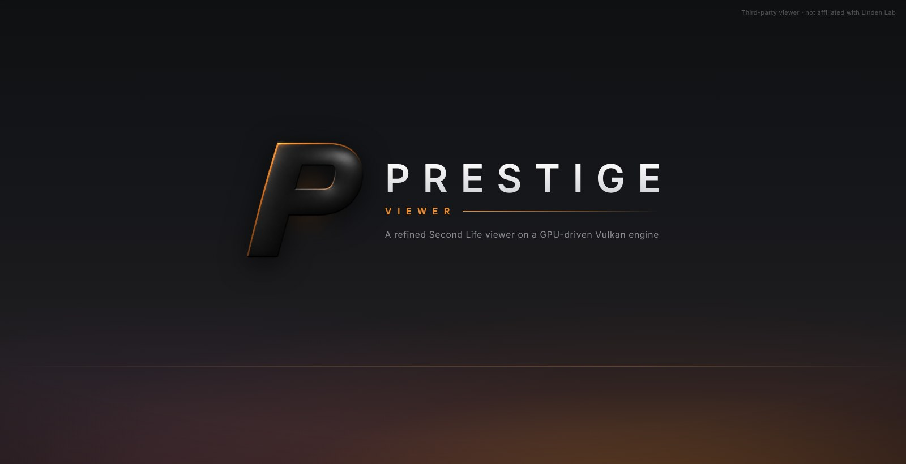

<p align="center">
  
</p>

<h1 align="center">Prestige Viewer</h1>

<p align="center"><b>A quality Second Life viewer running on Vulkan.</b></p>

<p align="center">
  
</p>

Prestige is a third-party viewer for Second Life with a clean, professional charcoal-and-orange interface and a modern rendering engine. Scene work runs on your graphics card rather than your processor, so busy places like clubs, events and crowded mainland stay smooth.

> Prestige is not provided or supported by Linden Lab, the makers of Second Life.

## Highlights

- **Vulkan renderer.** The whole visible scene is culled and drawn on the GPU with a handful of indirect draw calls, so crowds and dense builds don't bottleneck your CPU.
- **Ray-traced shadows** from the sun, moon and projectors on supported graphics cards, plus soft cascaded shadow maps on every other card.
- **Modern image quality.** HDR with multiple tone mappers, bloom, screen-space reflections, reflection probes, mirrors, ambient occlusion, depth of field, and FXAA / SMAA / TAA with temporal upscaling (FSR, and DLSS on NVIDIA).
- **Photo Studio** for colour grading, curves, scopes and depth of field, with snapshots up to 10240 × 4320.
- **Familiar tools:**
  - **People:** nearby-avatar radar, Contacts with contact sets, area search, teleport history.
  - **Avatar:** a poser, and an animation overrider.
  - **Interface:** pie menus, quick preferences, legacy profiles.
- **Your look, your colours.** Choose the charcoal-and-orange **Prestige** skin or **Prestige Pink** (pink, lavender and deep purple), or change any interface colour yourself in **Preferences → Skins → Customize colors**.
- **Smooth load-in.** Objects and avatars fade in gently while they load.
- **Privacy first.** Prestige collects no usage data and sends nothing about you anywhere.

## Requirements

- **Windows 10 or 11**, 64-bit.
- **A graphics card with a Vulkan 1.3 driver:** NVIDIA GTX 750 / 900 series or newer, AMD RX 400 series or newer, or Intel HD/UHD 500 / 600 series or newer.
- **Ray-traced shadows** need an NVIDIA RTX 20-series / AMD RX 6000 series or newer. Everything else works without them.

## Download

Test builds are produced automatically. Open the [Actions](../../actions) tab, pick the latest successful **Prestige Windows build**, and download **Prestige-Windows-x64** from the bottom of the page (you need to be signed in to GitHub). It contains:

- `Prestige_<version>_Setup.exe`: installs Prestige for your user account, with no admin prompt.
- `Prestige_<version>_win64.zip`: unzip it and run `PrestigeViewer.exe`.

Test builds aren't code-signed yet, so Windows SmartScreen may warn you. Choose **More info → Run anyway**.

## Checking that Vulkan is running

Open **Help → About** in Prestige. The information box lists the **Vulkan version**, whether **ray tracing** is active, and your graphics driver.

## Building from source

Prestige builds on Linux; the Windows version is cross-compiled. On Windows you can build inside WSL2. See [doc/prestige/DEVELOPER_NOTES.md](doc/prestige/DEVELOPER_NOTES.md) for the full guide.

```sh
make            # Linux build
make windows    # Windows x64 package (zip + installer)
```

## License

Prestige is free software, licensed under the **GNU LGPL 2.1** ([LICENSE](LICENSE), [doc/LICENSE-source.txt](doc/LICENSE-source.txt)). Full credits for the open-source work it builds on are in **Help → About** and in the source files.

Second Life and related marks are trademarks of Linden Research, Inc.
