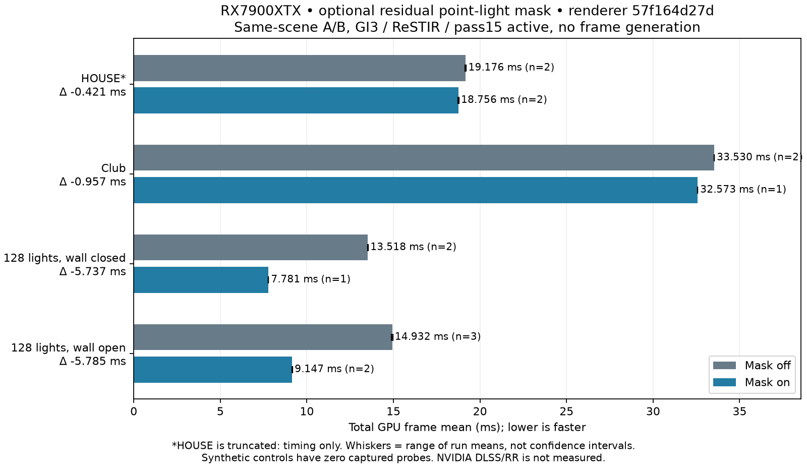

# Residual deferred point-light mask: measured prototype

`RenderVKPerfRadianceLightMask` remains optional, nonpersistent and default-off. Renderer source: `57f164d27d150b5f4c4a426c11071321fcd11cef`, based on `ae1f063eb7ca9c2c0e0bbec3921d2c21821e493a`. No ray budget, candidate PDF, denoiser, history or indirect-light population is changed. The option removes only point-light contributions already owned by active pass15 radiance. See [source proof and dense-light investigation](dense-local-lights.md).

## AMD total critical path

RX7900XTX, no frame generation, render1920×1033/output3840×2066. Every accepted run has actual GI3/ReSTIR/pass15 and complete required frame coverage. Compare within each row: same binary, capture, camera, settings and dimensions except the option. HOUSE is truncated with4680 missing textures and no captured avatars/probes: timing only. Club and dense synthetic controls have complete serialized geometry/textures and zero captured probes; they use the default environment fallback. Club covers recorded rigged motion, not live ingestion.

|Scene|Off mean ms (n)|Off range ms|On mean ms (n)|On range ms|On−off ms|Mean change|
|---|---:|---:|---:|---:|---:|---:|
|house|19.176448 (2)|0.061595|18.755632 (2)|0.033886|-0.420816|-2.194%|
|club|33.529853 (2)|0.004175|32.573343 (1)|0.000000|-0.956510|-2.853%|
|closed|13.517652 (2)|0.028827|7.780543 (1)|0.000000|-5.737109|-42.442%|
|visible|14.932036 (3)|0.081668|9.146615 (2)|0.035298|-5.785421|-38.745%|

Ranges are observed ranges of run means, not confidence intervals. A one-run B range of0 does not establish repeatability. The visible B2/A3 follow-up was added because the first image's temporal variation exceeded its initial A/A range; all repeats are retained. Warm-ups are excluded. These AMD results do not reproduce or quantify the RTX5090/3060 reports, and the mask does not solve hidden-light sampling noise.

## Stage attribution

|Scene|Deferred local off→on ms|Base VIS off→on ms|Adaptive VIS off→on ms|
|---|---:|---:|---:|
|house|0.695075→0.270775|2.888981→2.888834|0.882905→0.881170|
|club|1.655702→0.644354|2.304831→2.305944|1.236324→1.236699|
|closed|5.959363→0.273079|0.076440→0.074365|0.006735→0.006517|
|visible|5.986876→0.273606|0.542705→0.533351|0.006558→0.006598|

The total reduction tracks the deferred local-light reduction; visibility work remains essentially unchanged. These intervals overlap with other work and must not be added as independent savings. The dense closed result shows that reach-map rejection can remove most visibility work while a separate consumer still walks128 point lights to return zero.

## Per-run distributions

|Run|Frames|Mean ms|p50|p95|p99|
|---|---:|---:|---:|---:|---:|
|mask_house_a1|1594|19.207245|19.819559|21.982840|25.507240|
|mask_house_a2|1594|19.145650|19.710859|21.952400|26.005619|
|mask_house_b1|1594|18.772575|19.328199|21.497400|24.969681|
|mask_house_b2|1594|18.738689|19.264561|21.554159|25.670401|
|mask_club_a1|1594|33.527765|39.348640|44.861080|45.550678|
|mask_club_a2|1594|33.531940|39.346722|44.826641|45.853081|
|mask_club_b1|1594|32.573343|38.047241|43.390099|44.000481|
|mask_closed_a1|362|13.532065|13.305080|13.960680|20.856480|
|mask_closed_a2|362|13.503238|13.285960|13.806560|20.175560|
|mask_closed_b1|362|7.780543|7.623800|7.816040|13.470480|
|mask_visible_a1|362|14.951726|14.724120|15.583840|21.387280|
|mask_visible_a2|362|14.963025|14.724080|15.612240|21.382080|
|mask_visible_a3|362|14.881358|14.627400|15.617520|21.864519|
|mask_visible_b1|362|9.164264|9.008240|9.257920|14.673000|
|mask_visible_b2|362|9.128966|8.949240|9.236960|15.594920|

## Image/noise interpretation

Held240-frame images and full-resolution worst-difference crops show no obvious new missing-light or light-leak region in the reviewed complete controls. They are not bit-identical. Closed-mask mean-image A/B error0.135518 is comparable to A/A0.137395 output units. Club A/B errors are0.313237/0.173211/0.182169 versus A/A0.305822/0.126778/0.129989; the latter two exceed their initial A/A error, so strict statistical equivalence is not established. Reviewed worst crops concentrate differences in existing high-variance reflections/edges rather than a newly missing light contribution.

Visible-mask whole-image temporal standard deviation: A1/A2/A3=1.069835/1.036178/1.098532, B1/B2=1.122604/1.056160. The repeat does not show a consistent penalty; it also does not establish universal noise equivalence. Initial A/B mean-image error0.416903 versus A/A0.467771; follow-up A1/B2=0.466198 versus A1/A3=0.448607. These are Rec.709-weighted display values scaled0–255, not physical luminance or a perceptual quality score. Variance includes history/transients. Frozen stills do not test all moving-history response.

See [all image controls](images.md), raw-still SHA256 and metrics in `evidence/image-controls.json`. HOUSE images are excluded. No desktop default change follows: Pascal cannot validate RT/RR, NVIDIA DLSS Performance/Ultra Performance is unmeasured, and VR/projector/fallback/captured-probe correctness is not established by these point-light scenes. The source guards preserve those separate paths; broader validation remains necessary before promotion.
